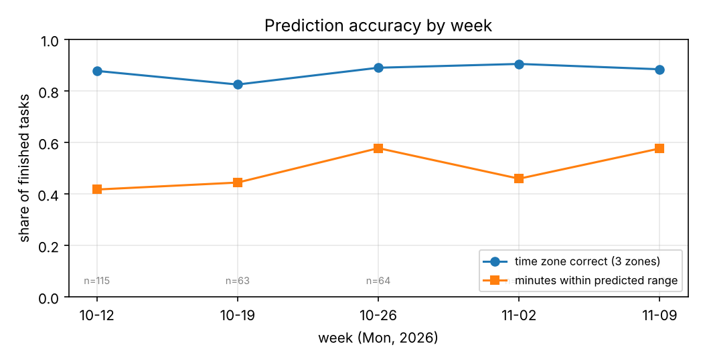
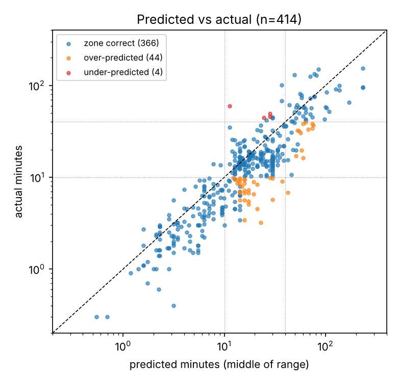

# agent-prediction — AI 에이전트 작업 시간 예측 기록

AI 에이전트(Claude 등)에게 일을 맡기기 **전에** 걸릴 시간과 토큰을 예측해 적고, 끝나면 **실측**과 비교해 **왜 빗나갔는지** 돌아보는 기록이다. 2026년 10월 13일부터 하루하루 쌓고 있다.

## 한 기록의 모양
| 단계 | 적는 것 |
|---|---|
| 예측 (보내기 전) | 분 범위(예: 10–25분), 사람에게 말한 시간 구간, 쓴 규칙, 그렇게 본 이유 |
| 실측 (끝난 뒤) | 걸린 분, 토큰(백만), 턴 수 |
| 돌아보기 | 맞았나, 빗나갔다면 틀린 조각과 까닭(조건 흐림 / 이유 틀림 / 바깥 상황 / 까닭 모름) |

시간 구간은 셋이다: **잠깐** ≤10분 · **다른 일** 10–40분 · **신경 끄기** >40분.

## 규모 (2026-11-09 기준)
- 기록 435건 (2026-10-13 ~ 2026-11-09), 그중 시간 판정이 된 끝난 기록 416건
- 모델: Opus 5.5 305건, Haiku 5.5 61건, Sonnet 5.5 15건, Fable 5.1 12건, GPT-6 계열 8건, 모델 칸 없음 34건(초기 기록)
- 일의 종류: 코드 구현, 문서·풀이지 작성, 웹 조사 등 12개 저장소

## 지금까지 본 것
1. **구간은 잘 맞지만 한쪽으로 치우쳐 있다.** 시간 세 구간 예측이 416건 중 367건(88%) 맞았다. 빗나간 49건 중 44건은 실제가 더 짧았다. 예측 범위의 가운데 값과 비교해도 414건 중 322건(78%)이 예측보다 빨리 끝났다(아래 그림 2).
2. **크기는 반만 맞는다.** 분 범위를 숫자 그대로 보면 416건 중 196건(47%)만 범위 안이다. 기록이 쌓이면 나아지는지 보고 있는데, 아직은 아니다 — 10월 47%(113/242), 11월 48%(83/174), 주별로도 42–58% 사이를 오간다(그림 1).
3. **원인을 가리지 못한 빗나감이 쌓인다.** 까닭을 정하지 못한 빗나감('까닭 모름')이 25건이다. "어떤 지시 방식이 시간을 줄였나"를 이 기록으로 묻고 싶지만, 그 방식을 고른 이유와 결과가 얽혀 있어(선택 편향) 관찰 기록만으로는 가를 수 없다.
4. **세부 숫자는 이제 모으기 시작했다.** 시간·토큰 말고 로그·git·클라우드 사용량 같은 세부 숫자가 붙은 끝난 기록은 80건이다(2026-11-03 무렵부터).

| 그림 1. 주별 적중률 | 그림 2. 예측 대 실측 (로그 눈금) |
|---|---|
|  |  |

## 기록으로 학습시켜 보기 (2026-11-09)
"쌓인 기록으로 예측을 학습시키면 사람(AI)이 손으로 한 예측보다 나을까"를 시험했다. 돌리기 전에 계획(입력, 모델, 성공 기준)을 먼저 적어 커밋했다 — 결과를 보고 기준을 고치지 않으려고.

- **방법**: 보내기 전에 알 수 있는 것만 입력으로 쓴다 — 일의 성질 표시(예/아니오 20개), 모델·추론 수준, 쓸 파일 수, 비슷한 지난 일의 실제 시간, 손 예측. 단순한 선형 모델(능선 회귀)을 기록마다 **그보다 앞의 기록 전부로 다시 배워** 그 한 건을 맞힌다. 실제로 쓸 때와 같은 모양이다.
- **잣대**: 사람에게 말하는 구간 하나(예측 범위 가운데 값의 구간)가 실제 구간과 같은가. 위 1번의 88%는 예측 범위가 걸치는 구간 중 하나에만 들어도 맞음으로 센 것이라 더 너그럽다. 여기서는 모든 방법을 같은 잣대로 쟀다.

| 방법 (시험 기록 267건) | 구간 적중 | 보통 빗나감 | 치우침 |
|---|---|---|---|
| 손 예측 | 82 % | 1.58배 | 1.5배 길게 잡음 |
| 일의 성질 표시만 학습 | 73 % | 1.59배 | 1.14배 |
| + 비슷한 지난 일의 시간 | 77 % | 1.46배 | 1.12배 |
| 손 예측을 학습으로 보정 | **84 %** | 1.43배 | 1.29배 |
| 전부 + 손 예측 | 81 % | **1.36배** | 1.05배 |
| 규칙을 손으로 짜 맞춘 계산기 (187건) | 35 % | 3.84배 | 1.55배 |

본 것:
1. **학습만으로는 손 예측을 못 넘는다. 손 예측을 고치는 데는 쓸 만하다.** 손 예측의 약점은 일관되게 길게 잡는 것이고, 학습은 그 치우침을 거의 없앤다. 보정은 대략 "손 예측 10분이면 7.6분, 40분이면 26분".
2. **같은 입력이면 단순 학습이 손으로 짠 계산기의 두 배를 맞힌다**(같은 187건에서 69 % vs 35 %). 계산기 규칙의 짜임새가 데이터와 안 맞는다는 신호로 보고 있다.
3. **모델을 하나로 묶으면 기계만으로 손 예측에 거의 닿는다.** Opus 5.5 high 기록 304건만 쓰면 '성질 표시 + 비슷한 지난 일' 모델이 77 %(손 예측 79 %)이고 빗나감은 더 작다(1.37배 vs 1.60배). 다만 '비슷한 지난 일'은 아직 AI가 고른다. 다른 모델은 기록이 15건 안팎이고 모델과 추론 수준이 늘 같이 바뀌어 효과를 가를 수 없다.
4. **기록을 더 모아도 지금 칸으로는 안 는다.** 마지막 119건을 고정하고 배우는 기록을 40건에서 290건으로 늘려도 빗나감이 그대로였다. 막는 것은 칸에 없는 정보(지시서를 읽어야 아는 일의 내용)와, 같은 일도 돌릴 때마다 생기는 흔들림(같은 지시서 반복에서 약 1.3배)이다.
5. **숫자로 잰 크기는 아직 적다.** 쓸 파일 수·지시 글자 수·지시서에 적힌 파일 크기는 실제 시간과 꽤 같이 움직이지만(순위상관 +0.44–0.60), 11월 초에 재기 시작해 29–95건뿐이다. 다만 손 예측이 빗나간 정도와는 거의 상관이 없다 — 손 예측이 이미 같은 정보를 읽고 있다. 그래서 이 숫자가 쌓이면 기계 예측이 손 예측 수준에 가까워질 수는 있어도 넘기는 어렵다고 본다.
6. **천장**: 빗나감 크기별로 구간 적중을 흉내 내 보면 1.6배 → 약 79 %, 1.36배 → 87 %, 흔들림 1.3배 → 약 89 %. 기계만으로 80 % 안팎, 손 예측 + 보정 85 % 안팎, 천장 90 % 근처로 본다.

처음에 거칠게 돌린 시험(한 지점에서 한 번 자르고 평균으로 잼)은 "학습 모델 2.8배 vs 손 예측 1.7배"로 훨씬 비관적이었다. 일의 종류가 시간에 따라 바뀌어서, 한 번 자른 모델은 뒤쪽의 새 종류를 못 배웠다. 학습은 최근 기록으로 계속 다시 해야 한다.

## 다음에 할 것
에이전트는 실험 조건을 내가 직접 정할 수 있다. 같은 종류의 일에 지시 방식 같은 조건을 **무작위로 나눠** 주는 대조 실험으로, 관찰 기록에서는 가를 수 없던 효과를 보려고 한다. 구체적인 설계는 아직 정하지 않았다.

## 데이터
`data/dispatches.csv` — 한 행 = 에이전트에게 보낸 일 하나. 숫자와 판정 칸만 담았고, 작업 설명·이유 같은 글은 빼었다(비공개 저장소 내용이 섞여 있어서).

| 칸 | 뜻 |
|---|---|
| `id`, `date`, `project` | 기록 번호, 날짜, 일한 저장소 이름 |
| `model`, `effort`, `round` | 보낸 모델과 추론 수준, 같은 에이전트의 몇 번째 회차인가 |
| `predicted_minutes_lo/hi` | 보내기 전에 적은 분 범위 |
| `predicted_zone` | 사람에게 말한 시간 구간 (2026-10-19부터 적음) |
| `written_before` | 예측을 보내기 전에 적었나 |
| `actual_minutes`, `actual_tokens_m`, `actual_turns` | 실측 분, 토큰(백만), 턴 |
| `zone_verdict` | 세 구간 기준 판정: 맞음 / 높게 잡음 / 낮게 잡음 |
| `minutes_in_range` | 실측 분이 예측 분 범위 안인가 |
| `review_why` | 빗나갔을 때 돌아보기의 까닭 갈래 |
| `has_detail_numbers` | 로그·git·클라우드 세부 숫자가 붙어 있나 |

## 만든 방식
기록 도구와 코드는 대부분 AI 에이전트가 짰고, 나는 무엇을 잴지 정하고(문제 정의), 기록 양식과 돌아보기 규칙을 설계하고, 결과를 검토하고 판단했다. 원본 기록과 도구는 [ZizonK7/proviso-nesy](https://github.com/ZizonK7/proviso-nesy)의 `domains/agent_usage/`에 있다.

재현: 원본 저장소를 받아 `python -m eda.export --out <폴더>`로 기록을 CSV로 펼치고, `python -m domains.agent_usage.dispatches`로 위 집계를 다시 볼 수 있다. 학습 시험은 `python -m eda.learn`(Opus high만 `--opus-high`, 배우는 건수별 `--curve`, 숫자 칸 `--numbers`)이고, 계획과 결과 전체는 원본 저장소의 `eda/report-2026-11-09-learn.md`에 있다. 이 저장소의 CSV에는 일의 성질 표시 칸이 없어 학습 시험은 여기서 재현되지 않는다.
